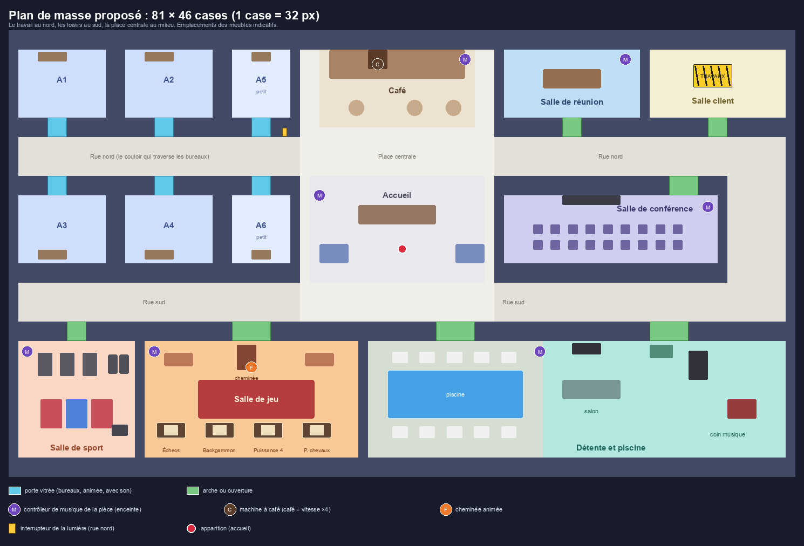

# Mise à jour du bureau : pièces, vitesse, café, modes, jeux et portes — plan d'intégration

> **Pour les agents qui l'exécutent :** sous-skill requis : superpowers:subagent-driven-development, ou superpowers:executing-plans. Les étapes se cochent (`- [ ]`).

**But :** refaire le bureau en deux ailes (le travail au nord, les loisirs au sud) avec des portes vitrées animées, de la musique réglable pièce par pièce, une salle de jeu à quatre jeux classés, des modes à la Apple qui téléportent, et un avatar deux fois plus rapide (quatre fois après un café).

**Architecture :**
- **Un registre de lieux** unique, lu dans la carte (zones `place`), remplace les rectangles écrits en dur dans `audio/scene-at.ts`, `office/where.ts` et les tests. La musique, les modes et les jeux s'appuient dessus.
- **Les bureaux ont une géométrie par place** (taille, côté de la porte) à la place de la constante globale `DESK_ROOM` : quatre grands (9 × 7) et deux petits (6 × 7), deux rangées face à face.
- **Tout ce qui change l'état du monde** (café, musique, mode, jeu) est décidé par le serveur, validé par zod, limité en débit, diffusé à tous et redit à l'`init`, comme la lumière aujourd'hui.
- **Les objets qui bougent** (portes, cheminée, enceintes, tapis de course, machine à café) sont des « props » animés : une planche d'images du pack LimeZu, une animation, éventuellement une zone d'interaction et une lumière de nuit.
- **Les jeux :** des règles pures partagées (`packages/shared/src/games/<jeu>/`), un serveur qui fait foi (coups, dés, classement), une interface React par jeu.

**Pile :** React 19, Phaser 4.2.1 (WebGL), Socket.IO 4.8, zustand 5, zod 4, Drizzle (Postgres ou PGlite), Vitest et happy-dom, Playwright. Aucune dépendance nouvelle sans accord (voir « Questions » pour `chess.js`).

**Spec :** la demande d'Andrea du 22 oct. 2026, reprise point par point ci-dessous. Pas de document de conception à part : Andrea a demandé directement le plan.

**Maquette du plan de masse :** [`2026-10-22-plan-de-masse.png`](2026-10-22-plan-de-masse.png) (emplacements des meubles indicatifs).

---

## Ce que je propose, point par point (à valider)

| # | Demande | Ce que je ferai | Choix par défaut à valider |
|---|---|---|---|
| 1 | Vitesse × 2 | Marche : 160 → **320 px/s**. Maj garde la vitesse d'aujourd'hui (**480 px/s**). | Si Maj restait à × 3 (960 px/s), elle dépasserait le café. Elle passe donc à × 1,5 sur la nouvelle marche. |
| 2 | Machine à café, café = × 4 | Une machine au café de la place centrale. Touche E ou clic à 2 cases. **30 s**, qu'un nouveau café remet à zéro. Tasse et vapeur au-dessus de la tête, compte à rebours en haut à gauche. | « × 4 » est lu **par rapport à la vitesse d'hier** : 640 px/s (960 avec Maj), soit × 2 sur la nouvelle marche. Lu par rapport à la nouvelle marche (1 280 px/s), il faudrait une physique à 240 Hz et des seuils réseau bien plus larges. Un seul réglage : `COFFEE_SPEED_FACTOR`. |
| 3 | Lumière selon la source | Chaque source a un profil : portée, **force** (part d'obscurité effacée), couleur, vacillement. Écran très faible, lampe de bureau faible et petite, lampadaire moyen, cheminée forte et large. Même profil pour bougies, poêle, LED des enceintes, eau de la piscine. | Les chiffres du tableau de T4 sont un départ, réglés à l'œil sur capture. |
| 4 | Bulle quand on parle | Une bulle pixel à trois points au-dessus de la tête de celui qui parle, **visible de toute la carte**. Elle remplace l'anneau du point. | Le serveur relaie la parole (LiveKit seul ne la montre qu'à la conversation). Pas de bulle micro coupé, ni en mode « sans être entendu ». |
| 5 | Zoom | **100 % = l'ancien 75 %.** Molette et pincement : **5 % par cran**, avec glissement fluide. Boutons et touches +/− : 10 %. De 25 % à 200 %. | Zoom non entier : léger scintillement possible des pixels (voir points d'attention). Sous 1 280 × 720, la base reste celle d'hier × 0,75. |
| 6 | Carte | Le plan de masse ci-dessous : 81 × 46 cases, deux rangées de bureaux face à face traversées par la rue nord. Réunion, conférence, client (en travaux), jeu, sport, détente et piscine, café, accueil. | Les petits bureaux sont les places A5 et A6, à l'est des quatre grands. Le décor d'un ancien A5/A6 qui ne tient plus est ignoré (jamais effacé). |
| 7 | Musique par pièce | Une **enceinte animée** dans chaque pièce (E : marche/arrêt) et un réglage dans la puce du lieu. État **partagé et enregistré** : couper la musique la coupe pour tous ceux qui sont dans la pièce. Dans son bureau, seul le propriétaire règle ; les visiteurs entendent ce qu'il a choisi. | Un choix personnel d'ambiance (panneau Son) reste un « casque » : il passe avant celle de la pièce. |
| 8 | Quatre jeux classés | Échecs, backgammon, puissance 4, petits chevaux, à la salle de jeu. Classement Elo enregistré. Inviter une personne connectée : elle accepte et est **téléportée autour de la table**. | 5 agents au plus : 1 Opus (règles et intégration), 4 Sonnet (un par jeu), tous en effort max. |
| 9 | Modes | Trois presets à la Apple : **Normal** (vert), **Concentration** (personne n'entre), **Sport** (téléporté à la salle de sport, ni entendu ni entendant ; à la sortie, retour au bureau). Dans « créer un mode » : les 3 interrupteurs, l'icône, la couleur et l'**emplacement sur la carte** (mini-carte). | Concentration ferme seulement la porte (comme tu l'as écrit). Sport coupe les deux sens : réglable. |
| 10 | Vraies portes | Portes **vitrées doubles** (planche LimeZu), animées ouvert/fermé, avec le son, sur les six bureaux. Pour qui a le droit de passer, la porte s'ouvre toute seule à l'approche. | Les arches des autres pièces restent des ouvertures. |

**Points de validation (dans l'ordre où ils bloquent le travail) :** après la vague 1 (le ressenti : vitesse, zoom, nuit, bulle), après la vague 3 (se promener dans la nouvelle carte), avant de lancer les 5 agents (coût), à la fin.

## Questions pour toi

1. **Branche et dossier.** Le PM2 de ton ordinateur sert le dossier principal en direct, avec ta vraie base `.data/dev`. Je propose un `git worktree` dédié (`../bureau-virtuel-pieces`, branche `update-pieces-jeux`) : ta carte et ton schéma ne changent qu'à la fusion. OK ?
2. **Les échecs et `chess.js`.** L'agent d'analyse recommande `chess.js` 1.4.0 (licence **BSD-2**, et non MIT comme je l'avais écrit ; 11,7 ko gzip, aucune dépendance). Sans ton oui, ce sont des règles écrites à la main, prouvées par des « perft » ; le contrat accepte les deux. Aucune dépendance ne s'ajoute sans ton accord.
3. **Pendule aux échecs.** Par défaut, pas de pendule : une partie inactive depuis 5 minutes est perdue par celui qui doit jouer. Une pendule se rajoute plus tard.
4. **Budget.** Tu n'as fixé aucun plafond ici. Je propose de mesurer (`get_usage`) après chaque vague et de te prévenir à chaque palier à fixer ensemble. Le plus gros poste : les 5 agents en effort max.
5. **Qui règle la musique d'une pièce.** Tous ceux qui y sont (par défaut), sauf dans un bureau : le propriétaire seul.
6. **Exécution.** Je recommande « natif » (je fais tout dans cette session, une relecture complète à la fin), sauf les 5 agents du jeu. Les tâches se partagent des fichiers (`protocol.ts`, `office-store.ts`, `fr.ts`, `styles.css`) : peu de gain à les paralléliser.

---

## Contraintes globales

- **Français partout :** interface, commentaires, messages de commit (`feat(client): …`). Phrases courtes, pas de majuscule de titre. Un bouton à icône seule a un nom accessible et une infobulle identiques.
- **Le serveur fait foi** pour la vitesse, le café, la musique, les modes, les portes et les jeux. Chaque nouvel événement a son schéma zod, sa limite de débit et son test de refus.
- **Aucune valeur de réglage en dur** : durées, portées, vitesses, forces de lumière sont des constantes nommées (dans `packages/shared/src/constants.ts`, ou en tête de leur fichier quand elles ne servent qu'au client).
- **Lumière allumée : le canevas du jour reste identique** au pixel près à zoom donné (la nuit ne dessine rien). Les tests e2e qui lisent des pixels (`e2e/world.spec.ts`) sont adaptés au nouveau zoom, jamais assouplis.
- **`prefers-reduced-motion`** : portes, bulle, téléportation, glissement du zoom et vapeur passent en changement instantané.
- **Téléphone :** toute nouvelle interface (modes et mini-carte, enceinte de la pièce, jeux) se vérifie à 375 px de large, comme le reste de l'appli.
- **Tests e2e sur la vraie carte :** les specs qui en ont besoin (portes, café, musique des pièces, modes, jeux) s'ajoutent à `OFFICE_SPECS` dans `e2e/playwright.config.ts` ; les autres restent sur la petite carte de développement, que cette mise à jour ne change pas.
- **Pas de `backdrop-filter`** sur les surfaces posées sur le canevas (coût à chaque image).
- **Nouvelles dépendances :** aucune sans ton accord.
- **Images et sons :** uniquement ceux des packs déjà utilisés (`~/Downloads/VIRTUAL-Desktop_V2_Ressources`, `~/Downloads/400 Sounds Pack`), rangés par `pnpm --filter @bureau/client gen:assets` et `gen:audio`. Même règle de licence : ces fichiers ne vont pas dans un dépôt public ; `CREDITS.txt` est mis à jour.
- **Base de données :** une migration Drizzle par changement de schéma (`0006_room_music.sql`, `0007_activity_place.sql`, `0008_games.sql`), jamais de modification d'une migration existante.
- **Bacs à sable :** les essais tournent sur `DATABASE_URL=memory://`, API sur le port 4100 et client sur 5273. **Jamais** les ports 3056 et 3057 du PM2 ni la base `.data/dev`. Après chaque essai avec du son, je ferme l'onglet du navigateur et j'arrête mes serveurs.
- **Commits :** un par tâche, `git add` des fichiers de la tâche seulement, message terminé par l'attribution demandée par l'outil.
- **Tests :** chaque tâche écrit d'abord ses tests (qui échouent), puis le code. Commande d'un fichier : `pnpm vitest run <chemin>` ; tout : `pnpm typecheck && pnpm test` ; e2e : `pnpm e2e -- <spec>`.

## Points d'attention (non couverts par un seul test)

1. **Vitesse élevée.** Un avatar à 960 px/s ne doit pas traverser un mur d'une case (physique Arcade à 120 Hz), les autres ne doivent pas le voir sauter (`TELEPORT_SNAP_PX`), et le serveur ne doit pas le recaler à la fin du café (limite relevée jusqu'à `MOVE_JITTER_MS` après). → T2.
2. **Carte changée sous des comptes existants.** Position enregistrée dans un nouveau mur, décor de A5/A6 devenu trop grand, tests qui lisent des coordonnées. → T6, T8, T9.
3. **Zoom non entier.** Le texte des étiquettes et l'obscurité de la nuit se redessinent à chaque image du glissement : leur résolution est arrondie. Les tests de pixels e2e changent de base. → T3.
4. **Modes qui déplacent.** Quitter le sport pendant que le bureau est exclu ou sans bureau, se déconnecter en mode sport, enchaîner deux modes à emplacement, destination pleine. → T13.
5. **Porte fermée sur quelqu'un.** Verrouiller pendant qu'une personne est sur le seuil ne doit pas la coincer dans le battant. → T10.
6. **Musique : deux personnes basculent en même temps**, ou l'état après une coupure. Idempotent, le serveur fait foi. → T12.
7. **Bulle bloquée.** Micro coupé, onglet en arrière-plan, déconnexion : la bulle s'éteint (délai de sécurité côté serveur). → T5.
8. **Jeux :** coup en double ou hors tour, reconnexion en pleine partie, abandon, classement compté deux fois, invitation à quelqu'un qui est parti, dés tirés côté client. → G2, G7.

---

## Plan de masse



**Idée :** le travail au nord, les loisirs au sud, une place au milieu. Deux rues parallèles (nord et sud) reliées par la place et par un connecteur à l'est : pas de cul-de-sac. La rue nord **traverse l'aile des bureaux** : deux bureaux de chaque côté, face à face, portes sur la rue.

Carte de **81 × 46 cases** (66 × 47 aujourd'hui). Un mur horizontal fait 2 cases de haut, un mur vertical 1 de large (convention de `MapCanvas`). Coordonnées en cases ; chaque intérieur est entouré de ses murs. J'ai vérifié ce plan avec un prototype Python resté hors du dépôt : 12 pièces, 13 ouvertures, aucun chevauchement, toutes les pièces joignables depuis l'apparition, chaque porte débouche sur du libre des deux côtés. **T8 refait ces mêmes contrôles en tests TypeScript, qui font foi.**

| Lieu | Clé | Intérieur (x, y, l × h) | Ouverture | Sol / murs | Contenu clé | Musique par défaut |
|---|---|---|---|---|---|---|
| Bureau A1 | `A1` | 1, 2, 9 × 7 | porte vitrée 4, 9 (2 × 2) | thème de l'occupant | poste par défaut | focus |
| Bureau A2 | `A2` | 12, 2, 9 × 7 | porte 15, 9 | idem | idem | focus |
| Petit bureau A5 | `A5` | 23, 2, 6 × 7 | porte 25, 9 | idem | poste réduit | focus |
| Bureau A3 | `A3` | 1, 17, 9 × 7 | porte 4, 15 (côté rue) | idem | idem | focus |
| Bureau A4 | `A4` | 12, 17, 9 × 7 | porte 15, 15 | idem | idem | focus |
| Petit bureau A6 | `A6` | 23, 17, 6 × 7 | porte 25, 15 | idem | poste réduit | focus |
| Rue nord | `street-n` | 1, 11, 78 × 4 | — | gris / — | plantes et fontaines entre les portes, **interrupteur** en 28, 10 | lobby |
| Place centrale | `plaza` | 30, 2, 20 × 28 | — | marbre | plantes, bancs | lobby |
| Café | `cafe` | 32, 2, 16 × 8 | — | damier | **machine à café**, comptoir, 3 tables, enceinte | sunny |
| Accueil | `reception` | 31, 15, 18 × 11 | — | marbre | comptoir, canapés, **apparition en 40, 22**, enceinte | lobby |
| Salle de réunion | `meeting` | 51, 2, 14 × 7 | porte 57, 9 | bleu clair / bleu ciel | écran, table 4 × 2, 10 chaises, enceinte | focus |
| Salle client | `client` | 66, 2, 14 × 7 | porte 72, 9 | blanc / crème | **panneau « en travaux » au milieu**, rien d'autre, pas d'enceinte | focus |
| Salle de conférence | `conference` | 51, 17, 22 × 7 | porte 68, 15 (3 × 2) | graphite / anthracite | écran, pupitre, deux rangées de chaises, enceinte | drift |
| Rue sud | `street-s` | 1, 26, 78 × 4 | — | gris / — | plantes | lobby |
| Connecteur est | `street-e` | 74, 11, 6 × 19 | — | gris | casiers, plantes | lobby |
| Salle de sport | `gym` | 1, 32, 12 × 12 | arche 6, 30 (2 × 2) | béton / anthracite | 3 tapis de course, 2 sacs de frappe, tapis de sol, râtelier, miroir, enceinte | quest |
| Salle de jeu | `game` | 14, 32, 22 × 12 | arche 23, 30 (4 × 2) | parquet brun / brun (chaleureuse) | **cheminée animée** au nord, canapés et fauteuils, grand tapis rouge, lampadaires, bougies, **4 tables** au sud, enceinte | dusk |
| Détente et piscine | `lounge` | 37, 32, 43 × 12 | arches 44, 30 et 66, 30 (4 × 2) | pierre (terrasse) puis parquet clair / menthe | **piscine 14 × 5**, transats, salon (télé, bibliothèque, aquarium), coin musique, enceinte | sunny |

**Clés des bureaux inchangées** (`A1` à `A6`) : les comptes gardent leur place, seule la géométrie bouge. Les quatre grands sont `A1` à `A4`, les petits `A5` et `A6`.

**Tables de la salle de jeu** (zones `game`, quatre sièges au plus, une table par jeu) : échecs, backgammon, puissance 4 (2 sièges chacune, 3 × 2 cases), petits chevaux (4 sièges, 3 × 3 cases). Les cases de siège sont des zones `seat` ; la ronde de spectateurs et d'arrivée par invitation est calculée autour de la table.

---

## Vue d'ensemble

| Vague | Contenu | Priorité | Peut tourner en parallèle |
|---|---|---|---|
| 0 | Préalable : branche, worktree, base de tests, lancement de G1 | P0 | — |
| 1 | T1 Interactions · T2 Vitesse · T3 Zoom · T4 Lumière · T5 Bulle | P0 | oui, cinq pistes ; `Office.ts`, `protocol.ts`, `fr.ts` et `styles.css` se fusionnent à la main |
| 2 | T6 Lieux, zones, bureaux de tailles différentes · T7 Assets · (G1 tourne déjà) | P0 | T6 ‖ T7 : fichiers disjoints (`packages/shared`, `apps/server` d'un côté ; `apps/client/scripts`, `public/assets` de l'autre) |
| 3 | T8 Nouvelle carte, puis T9 Reprise de l'existant | P0 | non : T9 suit T8 |
| 4 | T10 Portes · T11 Café · T12 Musique par pièce | P0 | oui, trois pistes ; protocole et magasin fusionnés à la main |
| 5 | T13 Modes · G2 Plateforme des jeux | P0 | oui ; les deux touchent `protocol.ts`, `office-store.ts` (sections différentes) |
| 6 | G3 à G6 : les quatre jeux (4 agents Sonnet, un worktree chacun) | P0 | oui |
| 7 | G7 Intégration des jeux · T14 Finitions et vérification complète | P0 | non |

**Points de contrôle avec toi :** fin de vague 1 (vitesse, zoom, nuit, bulle, sur capture), fin de vague 3 (la carte à l'écran), fin de vague 5 (modes, musique, café), **avant la vague 6** (lancement des agents, coût), fin de vague 7.

**Captures :** à chaque point de contrôle, sur le bac à sable (ports 4100 et 5273), envoyées avec `SendUserFile`.

---

### Étape 0 : préalable

**Fait le 22 oct. 2026**, avec trois écarts par rapport à ce qui était écrit : les 115 lignes de l'ancien plan étaient déjà commitées par Andrea (`a32e6ef`), la branche `refonte-ui-nuit` n'existe plus (`main` la contient), et le plan est commité sur la branche d'intégration plutôt que sur `main`.

- [x] Tu valides ce plan, ses 10 choix par défaut et les 6 questions.
- [x] Les 115 lignes non commitées de `docs/superpowers/plans/2026-10-21-refonte-ui-nuit.md` : déjà commitées (`a32e6ef`), rien à faire.
- [x] Ce plan et sa maquette sont commités : `b347019`, `docs: plan des pièces, modes et jeux`, sur `update-pieces-jeux`.
- [x] `git worktree add ../bureau-virtuel-pieces -b update-pieces-jeux` depuis `main` (`a32e6ef`), puis `pnpm install` dans le worktree. La session travaille dans ce dossier.
- [x] `pnpm typecheck && pnpm test` passent : 136 fichiers, 2 453 tests, 3 min 30. La suite e2e (`pnpm e2e`, environ 3 minutes) n'a pas été lancée ; elle a 1 à 2 tests lourds qui expirent parfois (`personnalisation.spec.ts:38`, `multiplayer.spec.ts:240`) et passent seuls : on les relance seuls avant d'y voir une régression.
- [x] `get_usage` au départ : 28 % de l'hebdo (toutes versions), 0 % sur les 5 heures.
- [x] **G1 lancé** (Opus, effort max), il a livré son document en 66 min (voir la tâche G1).

---

## Vague 1 : le ressenti

**Faite le 22 oct. 2026**, en ligne et une tâche après l'autre (pas en cinq pistes : elles touchent toutes `Office.ts`) : T1 `614a72e`, T2 `d772f87`, T3 `9d068f7`, T4 `564e9b1`, T5 `05d000b`, plus `5dfeee0` (une course de test préexistante, vue sous la charge de la suite complète). `pnpm typecheck` vert ; `pnpm test` : 144 fichiers, 2 636 tests ; `pnpm e2e` : projet `chromium` 56 verts et 6 ignorés (LiveKit absent), projet `office` 10 verts en série. `get_usage` : 31 % de l'hebdo (toutes versions), 5 % sur les 5 heures. Captures envoyées avec `SendUserFile` (nuit, dock du zoom, bulle).

### Tâche 1 : un seul gestionnaire de la touche E (P0, S)

**Pourquoi :** aujourd'hui chaque `LightSwitch` écoute la touche E pour lui. Avec la machine à café, les enceintes et les tables de jeu, E actionnerait plusieurs objets à la fois.

**Fichiers**
- Créer : `apps/client/src/game/interactions.ts`, `interactions.test.ts`, `apps/client/src/game/objects/InteractionPrompt.ts` (l'étiquette « [E] … » unique, au style de `TAG_TEXT_STYLE`).
- Modifier : `game/light-switch.ts` (devient une cible : plus de `bindUseKey`, plus d'étiquette à lui), `game/scenes/Office.ts` (un `Interactions`, un seul `bindUseKey`), `game/light-switch.test.ts`.

**Interfaces**
- Produit, tel que livré :
  ```ts
  export interface Point { x: number; y: number }
  export interface Interactable {
    id: string;
    pos: Point;                        // centre, en pixels
    reachTiles: number;                // inclusive, en ligne droite depuis les pieds
    labelAt?: Point;                   // le bas, au milieu de l'étiquette ; `pos` par défaut
    prompt(): string | null;           // « [E] Éteindre la lumière » ; null : rien à faire ici maintenant, la cible est ignorée
    use(): void;
  }
  export class Interactions {
    constructor(options?: { feet?: () => Point });                 // les pieds de l'instant : update, use et useTarget les relisent quand on n'en donne pas
    register(target: Interactable): () => void;                    // rend la fonction qui retire la cible
    update(feet?: Point): Interactable | null;                     // la plus proche à portée ; à égalité, la première enregistrée
    use(feet?: Point): boolean;                                    // la touche E ; faux sans cible
    useTarget(target: Interactable, feet?: Point): boolean;        // un clic sur l'objet : lui seul, à portée seulement
    onChange(listener: (current: Interactable | null) => void): () => void;
  }
  // objects/InteractionPrompt.ts : new InteractionPrompt(scene) ; show(target | null) à chaque image ; setZoom(zoom) ; destroy()
  // light-switch.ts : new LightSwitch(scene, pos, interactions, onUse) ; la plaque, le témoin, setOn ; plus d'étiquette ni de touche à lui
  ```

**Étapes** (faites le 22 oct. 2026 ; ajouts au brief : `labelAt`, `useTarget` et l'option `feet`, que le clic sur la plaque et la relecture des pieds à chaque appui demandaient)
- [x] Tests (`interactions.test.ts`, 17), vus échouer puis passer : la cible la plus proche à portée, hors de portée, `prompt()` nul, égalité, `use()` sans cible, cible retirée, `onChange` ; en plus la portée inclusive, `useTarget`, le fournisseur de pieds. `InteractionPrompt.test.ts` : 9 tests.
- [x] `light-switch.test.ts` (20) : l'interrupteur se comporte comme avant (portée de 3 cases, texte « [E] … », bascule à l'annonce du serveur). Le test de la touche E dans un champ de saisie reste à `input.test.ts` (`bindUseKey`).
- [x] `Interactions` (pur, sans Phaser) et `InteractionPrompt` ; `LightSwitch` et `Office.ts` branchés (un `Interactions`, un seul `bindUseKey`, une seule étiquette).
- [x] `pnpm vitest run apps/client/src/game` : 22 fichiers, 366 tests ; projet client entier : 91 fichiers, 1 620 tests ; `pnpm typecheck` vert.
- [x] Commit : `feat(client): un seul gestionnaire pour la touche E`.

### Tâche 2 : vitesse × 2, physique, réseau et serveur (P0, M)

**Fichiers**
- Créer : `packages/shared/src/movement/speed.ts` et son test.
- Modifier :
  - `packages/shared/src/constants.ts` : `WALK_SPEED_PX_PER_S = 320`, `SPRINT_FACTOR = 1.5`, `COFFEE_SPEED_FACTOR = 2`, `NORMAL_MAX_SPEED_PX_PER_S = WALK × SPRINT` (480, **la même limite qu'aujourd'hui**), `MAX_SPEED_PX_PER_S = NORMAL × COFFEE` (960), `TELEPORT_SNAP_PX = 8 * TILE_SIZE` ; commentaires remis à jour.
  - `packages/shared/src/movement/validate-move.ts` : paramètre `maxSpeed`.
  - `packages/shared/src/protocol.ts` : `tp?: true` sur chaque mouvement de `WorldTick` ; `'debug:boost'` (E2E seulement).
  - `apps/server/src/realtime/world.ts` (`setBoost`, `maxSpeedOf`, marque `tp` dans `teleport`), `handlers.ts` (`debug:boost`).
  - `apps/client/src/game/objects/LocalPlayer.ts` (`step(dir, sprint, boosted)`), `game/config.ts` (pas de la physique Arcade à 120 Hz au lieu de 60 : `physics.arcade.fps`, nom de l'option à vérifier dans Phaser 4.2.1), `game/snapshot-buffer.ts` et `objects/RemotePlayer.ts` (un `tp` saute tout de suite), `game/scenes/Office.ts`, `game/debug.ts` (`boost(ms)`).
  - Tests existants qui citent 160 ou 3 : `auto-walk.test.ts`, `snapshot-buffer.test.ts`, `packages/shared/test/*`, `apps/server/test/world.test.ts`, `e2e/world.spec.ts`.

**Interfaces**
- Produit, tel que livré :
  ```ts
  // shared/constants.ts : WALK_SPEED_PX_PER_S 320 · SPRINT_FACTOR 1,5 · COFFEE_SPEED_FACTOR 2 · NORMAL_MAX_SPEED_PX_PER_S 480 · MAX_SPEED_PX_PER_S 960 · TELEPORT_SNAP_PX 256
  export function speedOf(sprint: boolean, boosted: boolean): number;            // 320 · 480 · 640 · 960
  export function validateMove(m: OfficeMap, from: Timed, to: Timed, maxSpeed?: number): MoveResult;   // défaut : NORMAL_MAX_SPEED_PX_PER_S
  // WorldTick.moves[i] : { id, x, y, dir, moving, tp?: true } ; ClientToServer : 'debug:boost': { ms } (E2E=1 seulement, schéma debugBoostSchema)
  // World (serveur)
  setBoost(id: string, ms: number | null): void;   // `ms` de café À PARTIR DE MAINTENANT (la plan disait « untilMs » : voir le registre) ; null le retire ; un inconnu est ignoré
  maxSpeedOf(id: string): number;                  // 960 jusqu'à `fin + MOVE_JITTER_MS`, sinon 480 ; leave() efface le café
  // client : SnapshotBuffer.push(at, s, jump = false) · RemotePlayer.push(at, s, jump = false) · stepAnimationScale(speed) (game/step-animation.ts)
  //          LocalPlayer.step(dir, sprint = false, boosted = false), currentSpeed() · window.__office.boost(ms) / boosted() / speed()
  ```

**Étapes** (faites le 22 oct. 2026)
- [x] Tests vus échouer puis passer : `speed.test.ts` (5), `validate-move.test.ts` (+5), `world.test.ts` du serveur (+9 : le café, `tp`), `realtime-world.test.ts` (+11 : `debug:boost`, dont un test de mutation vérifié), `snapshot-buffer.test.ts` (+4 ; les tests existants qui encodaient 160 px/s et 480 px/s sont réécrits à partir des constantes), `step-animation.test.ts` (4).
- [x] Implémenté ; tout ce qui dépendait de `MAX_SPEED_PX_PER_S` relu (`validate-move`, `snapshot-buffer`) ; `move-sender` n'a pas changé. Ajouts au brief : la cadence des pas suit la vitesse (`stepAnimationScale`), la physique Arcade à 120 Hz (`physics.arcade.fps`, option vérifiée dans Phaser 4.2.1 : pas fixe, boucle sans plafond de pas).
- [x] E2E (`world.spec.ts`, 20 tests) : la marche et la course lisent la vitesse exacte de la physique (`window.__office.speed()`), au lieu d'une mesure sur le temps de la machine ; le café : 640, puis 960 avec Maj, et le mur de droite arrête l'avatar à x ≤ 726 avec le processeur ralenti 4 fois.
- [x] `pnpm typecheck` vert ; `pnpm test` : 140 fichiers, 2 511 tests (les 2 453 d'avant, dont quelques-uns réécrits, et 58 nouveaux).
- [x] Commit : `feat: la marche va deux fois plus vite, et le serveur connaît la vitesse du café`.

### Tâche 3 : zoom au pas de 5 % (P0, M)

**Fichiers**
- Modifier :
  - `apps/client/src/game/zoom.ts` : niveaux remplacés par des pourcentages ;
  - `game/scenes/Office.ts` : glissement de la caméra, molette ;
  - `game/input.ts` (`bindZoomKeys`) ;
  - `state/office-store.ts` : `zoomLevel` devient `zoomPercent`, `stepZoom(steps: number)`, `setZoomPercent`, `resetZoom` ;
  - `office/ZoomDock.tsx` (affiche « 100 % », clic = retour à 100 %) ;
  - `game/objects/NameTag.ts` et `game/lighting.ts` (résolution arrondie) ;
  - tests : `zoom.test.ts`, `office-store.test.ts`, `ZoomDock.test.tsx`, `input.test.ts`, `e2e/world.spec.ts` (tests de pixels et de zoom).

**Interfaces**
- Produit, tel que livré :
  ```ts
  // game/zoom.ts
  ZOOM_BASE_FACTOR 0.75 · ZOOM_MIN_PERCENT 25 · ZOOM_MAX_PERCENT 200 · ZOOM_DEFAULT_PERCENT 100 · ZOOM_WHEEL_STEP 5 · ZOOM_BUTTON_STEP 10 · ZOOM_GLIDE_MS 80
  clampZoomPercent(percent): number                  // bornes, cran de 5 %, NaN → 100
  stepZoomPercent(percent, steps, size = 5): number  // `steps` crans de `size` % sur la grille de `size` (10 % depuis 25 % donne 30 %, puis 40 … 100)
  cameraZoom(width, height, percent): number         // chooseZoom(...) × 0,75 × percent / 100
  easeZoom(current, target, dtMs): number            // exponentiel, constante de temps 80 ms, en rapport de zooms ; se pose à 0,1 % près
  ceilToQuarter(zoom) · textResolution(zoom) = max(1, ceilToQuarter(zoom))
  class WheelZoom { feed(deltaY, deltaMode, pinch, now): number; reset(): void }   // crans signés de 5 % : molette crantée = 1 cran, pavé tactile 25 px/cran, pincement 8 px/cran
  // game/input.ts : bindWheelZoom(target: HTMLElement, onSteps: (steps: number) => void): () => void   (arrête toujours l'événement) ; bindZoomKeys inchangé (+1 | −1 | 0)
  // state/office-store.ts : zoomPercent · setZoomPercent(p) · stepZoom(steps, size = 5) · resetZoom()
  // game/reduced-motion.ts : prefersReducedMotion()   (partagé par lighting.ts et Office.ts)
  // game/lighting.ts : NIGHT_SIZE_STEP = 64   (la texture de la nuit change de taille par paliers)
  ```

**Étapes** (faites le 22 oct. 2026)
- [x] Tests vus échouer puis passer : `zoom.test.ts` (pourcentages, bornes, `cameraZoom` 1,5 et 0,75, grille de 5 et de 10 %, `easeZoom` converge sans dépasser, indépendant du rythme des images, `WheelZoom` : cran de molette, pavé tactile, pincement, reste, pause, sens inverse), `office-store.test.ts` (part à 100 %), `ZoomDock.test.tsx` (trois boutons, le pourcentage), `SocialDock.test.tsx`, `input.test.ts` (`bindWheelZoom` : Ctrl + molette est arrêté), `InteractionPrompt.test.ts` (résolution au quart, un seul redessin pendant un glissement), `lighting.test.ts` (texture par paliers de 64 px), `ControlBar` et `OfficeShell` (le bouton du milieu).
- [x] Implémenté : `Office.glideZoom()` à chaque image (dans `afterPhysics`, avant la nuit), `retargetZoom()` à chaque changement de pourcentage, `layoutCamera()` (démarrage, redimensionnement) prend le zoom tout de suite ; mouvement réduit : saut direct. Résolution du texte au quart (`NameTag`, `InteractionPrompt`) ; texture de la nuit par paliers de 64 px.
- [x] E2E (`world.spec.ts`, 23 tests) : la molette, le pincement (Ctrl + molette arrêté, pas de zoom de la page), les boutons, le menu « Plus » et les touches ; la caméra glisse (zooms intermédiaires, jamais de recul ni de dépassement) ; mouvement réduit : aucun zoom intermédiaire ; la carte et l'avatar aux zooms ×1,5 et ×0,75 ; les tests de netteté passent à 200 % (×3, le seul zoom entier atteignable : restes modulo 3 au lieu de la parité), plus un test de couture à 100 %.
- [x] Captures à 75 %, 100 % et 150 % (×1,125, ×1,5, ×2,25) : la forme d'un même bureau (rectangle et colonnes de pixels) est identique sur 14 images de marche à chaque zoom, la caméra suivant l'avatar dans une fenêtre de largeur impaire. Pas de scintillement : le défilement de la caméra n'est pas arrondi (`pixel-snap.ts` suffit).
- [x] `pnpm typecheck` vert ; `pnpm test` : 140 fichiers, 2 547 tests ; `pnpm e2e world.spec.ts --project=chromium` : 23 tests.
- [x] Commit : `feat(client): zoom fluide au pas de 5 %, la vue de départ passe à l'ancien 75 %`.

### Tâche 4 : la lumière selon la source (P0, S)

**Fichiers**
- Modifier : `apps/client/src/game/light-sources.ts` (profils), `game/lighting.ts` (la force), `game/light-sources.test.ts`, `game/lighting.test.ts`, `game/light-textures.ts` (si le motif de palier demande un second jeu de textures).

**Interfaces**
- Produit, tel que livré :
  ```ts
  export type LightKind = 'lamp' | 'screen' | 'fire' | 'tv' | 'glow' | 'candle' | 'water';
  export interface LightFlicker { amplitude: number; hz: number }          // la portée bouge de ± amplitude, autour de hz
  export interface LightProfile { radiusTiles: number; strength: number; color: number; flicker?: LightFlicker }
  export const LIGHT_PROFILES: Readonly<Record<LightKind, LightProfile>>;   // `lamp` = la lampe de bureau
  export interface LightEmitter { kind: LightKind; radiusTiles?: number; strength?: number; bulbY: number }   // portée et force propres : le lampadaire, la lampe de chevet
  export interface LightSource { x; y; kind; radius; color; strength: number; flicker?: LightFlicker }        // `sourcesFromItems` les résout depuis le profil
  // lighting.ts : le trou est tamponné avec `alpha: strength` ; teinte et halo à `level × strength` ; le vacillement vient des données (flickerFactor)
  ```
  La force et la couleur viennent du profil de la sorte, **sauf** celles qu'un élément dit lui-même : le tableau ci-dessous a plusieurs lignes `lamp` (bureau, chevet, sol) et deux `fire` (cheminée, poêle), qu'un profil par sorte ne peut pas porter seul.

**Profils de départ**

| Sorte | Éléments | Portée (cases) | Force | Remarque |
|---|---|---|---|---|
| `screen` | écrans, portables | 1,5 | 0,22 | très faible, froide |
| `lamp` bureau | lampes articulées | 2 | 0,55 | faible et petite |
| `lamp` chevet | lampes de chevet | 1,75 | 0,5 | |
| `lamp` sol | lampadaires | 4 | 0,8 | moyenne |
| `tv` | télévisions murales | 3 | 0,35 | froide, vacille à 6 Hz |
| `candle` | bougies | 1,5 | 0,4 | vacille |
| `fire` | cheminée animée | 6 | 0,95 | forte et large, vacille ±5 % |
| `fire` | poêle | 3,5 | 0,7 | |
| `glow` | LED des enceintes, machine à café | 0,9 | 0,15 | à peine un point |
| `water` | piscine (3 sources le long du bassin) | 5 | 0,35 | aqua, sans vacillement |

**Étapes** (faites le 22 oct. 2026)
- [x] Tests vus échouer puis passer : `light-sources.test.ts` (les sept profils, le feu le plus fort et le plus large, une LED n'est qu'un point, le vacillement, chaud et froid ; chaque élément a un profil ; l'ordre feu > lampadaire > lampe de bureau > écran ; les écrans d'ordinateur très faibles, les écrans éteints n'éclairent pas), `lighting.test.ts` (le trou tamponné à `alpha = strength` ; teinte et halo à `0,22 × niveau` ; le vacillement ne dépasse pas son amplitude à 8, 6 et 3 Hz ; pas de vacillement en mouvement réduit ni sans donnée).
- [x] Implémenté. Hors du brief : les écrans d'ordinateur allumés de la banque (22 éléments : écrans bleus, sur pied, moniteurs compacts, doubles écrans, portables, postes complets) deviennent des sources `screen`, ce que l'intention d'origine demandait (« un écran très faible ») ; les écrans noirs et blancs de la banque sont éteints. Les deux télévisions murales passent en `tv`.
- [x] Captures de nuit sur la vraie carte (salon avec cheminée, salle de réunion, bureau avec lampe et écran, grande salle, toute la carte) : les chiffres de départ du tableau gardent leur ordre et leur taille à l'œil, aucun n'est changé.
- [x] `pnpm typecheck` vert ; `pnpm test` : 140 fichiers, 2 563 tests ; `pnpm e2e lumiere.spec.ts --project=office` : 1 test.
- [x] Commit : `feat(client): la nuit éclaire selon la source (écran, lampe, cheminée…)`.

### Tâche 5 : la bulle de parole (P0, M)

**Fichiers**
- Créer : `apps/client/src/net/speaking-reporter.ts` (+ test), `apps/client/src/game/objects/SpeechBubble.ts` (+ test).
- Modifier :
  - `packages/shared/src/constants.ts`, `protocol.ts` ;
  - `apps/server/src/realtime/world.ts`, `handlers.ts`, `io.ts` (si les événements y sont typés) ;
  - `apps/client/src/net/office-connection.ts`, `state/office-store.ts`, `media/use-media.ts` ;
  - `game/objects/NameTag.ts` (la bulle remplace l'anneau), `LocalPlayer.ts`, `RemotePlayer.ts`, `scenes/Office.ts`, `debug.ts` ;
  - tests : `NameTag.test.ts`, `use-media.test.tsx`, `apps/server/test/realtime-media.test.ts`, `e2e/media.spec.ts` ou un spec à part.

**Interfaces**
- Produit, tel que livré :
  ```ts
  // constants.ts
  export const SPEAKING_RATE = { max: 8, windowMs: 2_000 };
  export const SPEAKING_TTL_MS = 6_000;        // sans nouvelle de lui, le serveur éteint la bulle
  export const SPEAKING_HEARTBEAT_MS = 3_000;  // le client redit « je parle » tant qu'il parle
  // protocol.ts
  export const speakingSchema = z.boolean();
  'speaking:set': (speaking: boolean) => void;                          // client → serveur
  'speaking:changed': (p: { id: string; speaking: boolean }) => void;   // serveur → tout le bureau
  PublicPlayer.speaking?: boolean;                                      // init et player:joined
  // serveur : World.setSpeaking(id, speaking): boolean (vrai si l'état change) · World.expireSpeaking(): string[]
  // client : net/speaking-reporter.ts  createSpeakingReporter(send): { feed(speaking), stop() }  (SPEAKING_ON_DELAY_MS 150, SPEAKING_OFF_DELAY_MS 700)
  //          bus 'net:speaking' · store.setSpeaking(id, speaking) · window.__office.bubbles() · window.__office.media.speak(on)
  //          game/objects/SpeechBubble.ts  (BUBBLE_PIXELS 14 × 11, bubbleScale(zoom), dotLift(now, i), SpeechBubble)
  //          NameTag.setSpeaking / tick(now) / setZoom ; SpeakingBubbles (remplace SpeakingRings) : updateMedia, setServer, resetServer, forget, ids
  ```
- Règles, telles que livrées : le reporter allume après 150 ms de parole, éteint après 700 ms de silence, redit « vrai » toutes les 3 s. Le serveur ignore « je parle » quand le micro est coupé ou que l'état porté ne laisse pas entendre (`heard` faux) ; « je me tais » passe toujours. Il éteint la bulle à la déconnexion (sans attendre le délai de grâce), quand le micro se coupe, quand on prend un état où l'on n'est pas entendu, et à `SPEAKING_TTL_MS` ; il limite le débit par socket comme `status:set`, et ne rediffuse pas un « je parle » répété.

**Étapes** (faites le 22 oct. 2026)
- [x] Tests vus échouer puis passer : `speaking.test.ts` (shared), `world.test.ts` (`setSpeaking`, `expireSpeaking`, `leave`, `join`), `realtime-speaking.test.ts` (13 : micro allumé, micro coupé, deux états sans être entendu, prendre un tel état, couper le micro, charge invalide, battement, débit, déconnexion, TTL) avec un test de mutation (sept tests échouent quand les règles sont neutralisées), `speaking-reporter.test.ts` (15), `use-media.test.tsx` (+7 : parole locale, délais, quitter la room, démonté, coupure, crochet de test), `office-store.test.ts` et `office-connection.test.ts` (`speaking:changed`, `net:speaking`), `SpeechBubble.test.ts` (dessin, texture, échelle jamais sous 16 px, points qui montent, mouvement réduit), `NameTag.test.ts` (`SpeakingBubbles` à deux sources, la bulle dans l'étiquette, plus d'anneau).
- [x] Implémenté. Hors du brief : `window.__office.media.speak(on)` (les tests de bout en bout n'ont pas de room audio, donc pas de voix) et `window.__office.bubbles()`.
- [x] La bulle : pixel art tracé en code (14 × 11 px), au-dessus de l'étiquette, trois points qui montent l'un après l'autre (200 ms chacun, puis un temps de repos) ; l'anneau disparaît.
- [x] E2E (`multiplayer.spec.ts`) : A parle (crochet), sa bulle est allumée chez elle tout de suite et chez B, à l'autre bout de la carte, dans les secondes qui suivent ; elle s'éteint quand A se tait. Captures de la bulle à 100 % et à 25 % : lisible de loin.
- [x] `pnpm typecheck` vert ; `pnpm test` : 144 fichiers, 2 636 tests ; `pnpm e2e multiplayer.spec.ts presence.spec.ts world.spec.ts --project=chromium` : 38 tests.
- [x] Commit : `feat: une bulle au-dessus de celui qui parle, visible de loin`.

---

## Vague 2 : les fondations de la carte

### Tâche 6 : registre des lieux, nouvelles zones, bureaux de tailles différentes (P0, L)

**Fichiers**
- Créer : `packages/shared/src/map/places.ts`, `packages/shared/src/audio/scenes.ts` (`MUSIC_SCENES`), `packages/shared/test/places.test.ts`.
- Modifier :
  - `packages/shared/src/map/parse-map.ts` : types de zones et leurs règles ;
  - `packages/shared/src/decor/placement.ts` : `DeskRoomSpec` à la place de `DESK_ROOM` ;
  - `packages/shared/src/index.ts` ;
  - `apps/server/src/desks/desk-service.ts` et `desk-controller.ts` (géométrie par place) ;
  - `apps/client/src/game/decor-layer.ts`, `decor-editor.ts`, `office/decor-draft.ts`, `game/auto-walk.ts` ;
  - `apps/client/src/audio/catalog.ts` (importe `MUSIC_SCENES`) ;
  - tests : `packages/shared/test/{map,decor,office}.test.ts`, `apps/server/test/{desks,spawn}.test.ts`, `apps/client/src/office/decor-draft.test.ts`, `state/decor-editor.test.ts`.

**Interfaces**
- Produit :
  ```ts
  // parse-map.ts
  export const ZONE_TYPES = ['spawn','private','desk','door','label','switch','place','coffee','speaker','game','seat','sign'] as const;
  // place   : name = clé, propriétés label, kind ('room'|'open'|'street'), scene, music ('1'), destination ('1')
  // coffee  : 1 × 1, la case devant la machine
  // speaker : 1 × 1, l'enceinte ; name = clé de la place qu'elle règle
  // game    : la table ; name = 'chess' | 'backgammon' | 'connect4' | 'ludo'
  // seat    : 1 × 1 ; name = '<jeu>:<n>' (n à partir de 1)
  // sign    : rectangle ; propriété text
  export interface OfficeMap { …; places: Place[]; coffees: Point[]; speakers: Array<Point & { place: string }>; tables: GameTable[]; signs: Array<Rect & { text: string }> }
  // places.ts
  export interface Place { key: string; label: string; kind: 'room' | 'open' | 'street' | 'desk'; rects: Rect[]; scene: MusicScene; music: boolean; destination: boolean }
  export function placeAt(map: OfficeMap, x: number, y: number): Place | null;       // la plus petite place qui contient le point ; bureau si dans une zone desk
  export function placeByKey(map: OfficeMap, key: string): Place | undefined;
  export function freeSpotIn(map: OfficeMap, place: Place, taken: ReadonlyArray<Point>): Point | null;   // case praticable, déterministe, à 2 cases au moins des autres
  // placement.ts
  export interface DeskRoomSpec { width: number; height: number; door: { side: 'north' | 'south'; x: number; width: number } }
  export const DESK_ROOMS: { standard: DeskRoomSpec; compact: DeskRoomSpec };       // 9 × 7, porte x 3 · 6 × 7, porte x 2 (largeur 2)
  export function deskRoomSpecOf(map: OfficeMap, key: string): DeskRoomSpec | undefined;   // taille de la zone desk, côté de la zone door
  export function checkDecor(decor: DeskDecor, room?: DeskRoomSpec): DecorCheck;           // défaut : standard
  export function defaultDeskDecor(room: DeskRoomSpec): DeskDecor;                         // le poste réduit pour `compact`
  export function doorEntryCells(room: DeskRoomSpec): Point[];
  ```
- Règles de `checkDecor` ajoutées : un élément mural ne peut pas surplomber les cases de la porte quand elle est au nord (`blocks_door`).

**Étapes** (faites le 22 oct. 2026)
- [x] Tests vus échouer puis passer :
  - `parse-map` (`map.test.ts`, `places.test.ts`) : les nouveaux types sont reconnus ; une `place` sans `label`, de scène inconnue, de clé en double ou préfixée `desk:` est refusée ; un `speaker` dont la place n'a pas de musique est refusé ; un `seat` sans table du même jeu est refusé ; `coffees`, `speakers`, `tables`, `signs` sont lus ;
  - `places` : la plus petite place gagne, une zone desk rend `desk:<clé>`, hors de toute place `null`, `freeSpotIn` (praticable, déterministe, à 2 cases des autres, `null` quand c'est plein) ;
  - `decor` : le poste réduit tient dans la pièce compacte, qui refuse ce qui dépasse 6 cases ; porte au nord : ni meuble devant la porte ni tableau au-dessus ; chaque poste par défaut passe son propre `checkDecor` ;
  - serveur `desks` : la déco d'une place compacte est validée avec sa pièce ; un décor enregistré qui ne tient plus est ignoré (poste par défaut de la pièce), journalisé une fois, jamais effacé, et revient si la pièce redevient assez grande ;
  - client `decor-draft` et `state/decor-editor` : `anchorFor`, `tryPlace` et `planPlace` prennent la pièce ; une pièce compacte ramène un bureau à sa largeur de 6 cases, une porte au nord refuse un tableau au-dessus d'elle ; `roomOfDesk` (standard sans carte, sans porte ou pour une place inconnue).
- [x] Implémenté : plus aucun `DESK_ROOM` ni `DOOR_ENTRY_CELLS` (pas d'alias) ; `DeskSlot.room` côté serveur ; côté client, `DecorLayer` crée une pièce par zone desk que la carte décrit avec une porte (`deskRoomSpecOf`), son poste par défaut est `defaultDeskDecor(spec)` ; `DecorEditorView` (grille, case sous le pointeur, pose) et `auto-walk.ts` (`decorated`) suivent la même règle ; le panneau « Poste par défaut » remet celui de la pièce (`roomOfDesk`).
- [x] `MUSIC_SCENES` dans `packages/shared/src/audio/scenes.ts` ; `SCENE_IDS` du client est cette liste même (`satisfies readonly SceneId[]`) ; le test existant vérifie déjà que `measured.generated.ts` couvre chaque scène, un nouveau que la liste est celle du partage.
- [x] `pnpm typecheck` vert (client, serveur, partage, e2e) ; `pnpm test` : 145 fichiers, 2 700 tests ; `pnpm e2e personnalisation.spec.ts --project=office` : 6 verts (la déco du bureau sur la vraie carte, toutes les pièces standard).
- [x] Commit : `feat(shared): registre des lieux, nouvelles zones et bureaux de tailles différentes`.

**Tel que livré** (écarts au plan, tous au registre) : `desk-controller.ts` n'a pas changé (la géométrie par place est dans `DeskService`) ; `spawn.test.ts` non plus ; `GAME_IDS` est défini dans `parse-map.ts` (et `places.ts` n'importe que des types) pour éviter un cycle d'imports ; `Zone.properties` n'existe que pour `place` et `sign` ; une zone desk sans porte n'a plus de pièce décorée côté client (avant : toute zone de 9 × 7), alors que le serveur la valide en pièce standard.

### Tâche 7 : les images et les sons dont on a besoin (P0, M)

**Pourquoi :** le pack contient ce qu'il faut. J'ai regardé image par image les portes vitrées, la machine à café, la cheminée, les enceintes, le tapis de course, les sacs de frappe, les bougies et l'aquarium, ainsi que la planche Gym en entier et la moitié haute de la planche Basement (canapés, ping-pong, billard). **La moitié basse de Basement reste à regarder** (baby-foot, bornes d'arcade ?). La chaîne d'images, elle, ne sait pas encore lire les objets animés.

**Fichiers**
- Créer :
  - `apps/client/scripts/assets/animated.ts` : copie des planches animées vers `public/assets/props/<clé>.png` et génération de `packages/shared/src/props/generated.ts` ;
  - `packages/shared/src/props/catalog.ts` : le type `Prop` et l'accès par clé ;
  - `apps/client/scripts/assets/curation/gym.ts` et `curation/basement.ts` ;
  - son test (`pipeline.test.ts` existant : l'étendre).
- Modifier : `curation/types.ts` (planches `gy` = `8_Gym_32x32.png` et `ba` = `14_Basement_32x32.png`), `packages/shared/src/decor/types.ts` (catégorie `sport`), `apps/client/scripts/assets/build-assets.ts`, `scripts/audio/build-audio.ts`, `apps/client/src/audio/catalog.ts`, `measured.generated.ts` (généré), `apps/client/public/assets/CREDITS.txt`.

**Interfaces**
- Produit :
  ```ts
  export interface Prop {
    key: string;
    sheet: string;                 // /assets/props/<clé>.png
    frameWidth: number; frameHeight: number; frames: number; fps: number; loop: boolean;
    w: number; h: number; claim: number; solid: boolean;   // empreinte au sol, en cases (le bas de l'image)
    light?: LightKind;             // éclaire la nuit (T4)
  }
  ```

**Props retenus** (planches de `moderninteriors-win/3_Animated_objects/32x32/spritesheets/`, vérifiées image par image) :

| Clé | Planche | Images | Rôle |
|---|---|---|---|
| `door-glass-double` | `animated_door_glass_double` | 8 de 64 × 96 | porte des bureaux : image 0 fermée, 1 à 3 s'ouvre, 4 ouverte (battants de chant, quasi invisible), 5 à 7 se referme |
| `coffee` | `animated_coffee` | 6 de 32 × 64 | machine à café, vapeur en boucle |
| `chimney` | `animated_chimney` (4 teintes) | 3 de 64 × 96 | cheminée à feu animé, salle de jeu ; `light: 'fire'` |
| `amplifier`, `amplifier-big` | `animated_amplifier*` | 3 de 32 × 64 / 32 × 96 | enceinte : les cônes pulsent quand la musique joue ; `light: 'glow'` |
| `treadmill` | `animated_tapis_roulant` | 12 de 64 × 96 | tapis de course |
| `punching-bag-left`, `-right` | `animated_punching_bag_*` | 6 de 64 × 64 | sacs de frappe |
| `candle`, `wall-candle` | `animated_candle`, `animated_wall_candle` | 3 de 32 × 64 | bougies ; `light: 'candle'` |
| `fishtank` | `animated_fishtank_orange` | 8 de 64 × 64 | aquarium du salon |

**Sons** (tous du « 400 Sounds Pack », rangés par `gen:audio`) :

| Effet | Fichier | Usage |
|---|---|---|
| `door-open`, `door-close` | `Environment/door_open.wav`, `door_close.wav` | portes |
| `lock`, `unlock` | `Environment/lock_lock.wav`, `lock_unlock.wav` | verrouiller et déverrouiller |
| `coffee` | `Other/drink_slurp.wav` | prendre un café |
| `boost` | `Other/whoosh_2.wav` | début du café |
| `teleport` | `Other/whoosh_1.wav` | modes, invitation de jeu |
| `dice` | `Card and Board/dice_roll_1.wav` | backgammon, petits chevaux |
| `piece` | `Card and Board/chips_place_1.wav` | pion posé, coup joué |
| `win` | `Other/applause.wav` (écourté au besoin) | victoire |

**Étapes** (faites le 22 oct. 2026)
- [x] Tests vus échouer puis passer : `animated.test.ts` (`propFromSheet` lit la taille d'une image et l'empreinte, refuse une planche qui ne se partage pas, une image qui n'est pas un nombre entier de cases et une empreinte plus haute que l'image ; chaque prop a sa planche rangée, de la largeur de ses images, sans image vide ; les onze formes attendues) ; `pipeline.test.ts` (catégorie « Sport & jeux » en dernier, de quoi équiper une salle de sport et une salle de jeu, les tables de jeu bloquent sur toute leur surface et les sièges jamais, tapis au sol et miroirs au mur, aucun nom répété par catégorie) ; `build-audio.test.ts` (25 effets, les dix nouveaux et leurs fichiers du pack, un seul fichier par effet, `SFX_TRIMS` et le filtre d'extinction). Les deux contrôles du plan sur le pack lui-même (« chaque son existe dans le pack », « chaque effet a un gain mesuré ») : le second existait déjà (`catalog.test.ts`), le premier est fait par `gen:audio` (il s'arrête sur le fichier manquant) — un test qui lit `~/Downloads` casserait sur toute autre machine.
- [x] Curation : `curation/gym.ts` (46 éléments : tapis de yoga au sol, ballons, poufs, râteliers et supports, kettlebells, disques, haltères, bancs et appareils, tapis de course, trois miroirs muraux) et `curation/basement.ts` (44 éléments : quatre canapés, huit fauteuils, huit tabourets, trois tables rondes, ping-pong, billard, bornes d'arcade, râtelier de queues, meuble télé, coussins, grand tapis, vases). Planches annotées par `scratchpad/sheets` (découpe automatique, case de départ de chaque objet) ; nouvelle catégorie `sport` (« Sport & jeux »). Les helpers `on` et `named` passent dans `curation/helpers.ts`.
- [x] Objets animés : `animated.ts` (14 planches, dont les quatre teintes de la cheminée), `packages/shared/src/props/catalog.ts` (`Prop`, `PROPS`, `propByKey`, `LIGHT_KINDS`) et `generated.ts`, planches dans `public/assets/props/`. `LightKind` vient maintenant du partage (le client le ré-exporte).
- [x] `gen:assets` : 541 éléments dans 10 atlas, 14 objets animés. `gen:audio` : dix effets de plus ; `SFX_TRIMS` écourte la victoire (applaudissements de 11,8 s) à 3,5 s avec 0,8 s d'extinction ; les `.ogg` des ambiances, que `gen:audio` réécrit avec un autre conteneur, sont remis tels quels (le son est le même). Les dix effets ont leur niveau et leur délai de repos dans `audio/catalog.ts`.
- [x] `CREDITS.txt` : objets animés, sport, sous-sol, dossiers Environment et Card and Board.
- [x] `pnpm typecheck` vert ; `pnpm test` vert.
- [x] Commit : `feat(client): objets animés, planches sport et jeux, sons des portes et du café`.

---

## Vague 3 : la nouvelle carte

### Tâche 8 : la nouvelle carte (P0, L)

**Fichiers**
- Réécrire : `packages/shared/src/map/office.ts`.
- Modifier : `packages/shared/src/map/builder.ts` (`prop`, `place`, `sign`, `table`, `seat`, `coffee`, `speaker` ; calque `props` dans `toTiled()`), `packages/shared/src/map/tiled-types.ts`, `apps/client/public/assets/maps/office.json` (généré par `gen:map`), `apps/client/src/game/map-layers.ts`.
- Créer : `apps/client/src/game/prop-layer.ts` (+ test) : dessine les props du calque `props`, anime, trie par profondeur du bas, expose `byKey` pour les portes, la musique et le café ; `packages/shared/test/office.test.ts` réécrit.

**Interfaces**
- Produit :
  ```ts
  export const OFFICE_WIDTH = 81, OFFICE_HEIGHT = 46;
  export interface OfficeDeskSlot { key: string; room: Rect; door: Rect; doorSide: 'north' | 'south'; walls: Array<{ x: number; y: number; part: 'top' | 'bottom' | 'stem' }> }
  export const OFFICE_DESK_SLOTS: OfficeDeskSlot[];      // A1 à A6, les deux dernières compactes
  export const OFFICE_SPAWN = { x: 40, y: 22 };
  // MapCanvas
  prop(key: string, x: number, y: number): void;         // bloque l'empreinte si solide
  ```
  Les constantes `MEETING_ROOM`, `GRAND_HALL`, `LOUNGE`, `POOL`, `PLAZA`, `LOUNGE_*` **disparaissent** : on lit `placeByKey(map, 'game')` etc.

**Étapes** (faites le 22 oct. 2026)
- [x] Tests vus échouer puis passer : `map-builder.test.ts` (`prop` : l'empreinte seule bloque, un prop sur un mur ou un meuble solide ou hors de la carte est refusé, le calque `props` avec la clé, la position et la taille de l'empreinte, `onTop` et `offsetY` ; `place`, `coffee`, `speaker`, `table`, `seat`, `sign` relus par `parseOfficeMap`) ; `office.test.ts` réécrit (35 tests : 81 × 46 ; A1 à A6 et leurs pièces ; l'enceinte, la machine, les tables et leurs sièges, le panneau, l'interrupteur ; aucun chevauchement ; chaque salle fermée sauf à ses ouvertures ; les bandes de mur ne sont percées qu'aux ouvertures ; chaque porte et chaque arche libre des deux côtés ; tout est joignable depuis l'apparition et aucune case libre n'est enfermée ; les lieux, leurs rectangles et leur ambiance ; la table de réunion et ses dix chaises ; les fontaines hors de l'axe d'une porte ; le calque `props`) ; client : `prop-textures`, `prop-layer` (mise en place, profondeur, `offsetY`), `light-sources` (`sourcesFromProps`), `map-signs`.
- [x] Carte dessinée dans `office.ts` d'après le plan de masse (douze lieux, treize ouvertures, sept enceintes, quatre tables et dix sièges, la machine à café et sa case de service, le panneau de la salle client) ; mobilier de la banque et objets animés posés pièce par pièce, rien dans les bureaux. `gen:map` : `office.json` ; `map:check` : « Carte valide », 81 × 46.
- [x] Client : `PropLayer` (sprites animés, triés par le bas de leur empreinte, première image en mouvement réduit), `prop-textures.ts` (planches chargées par le Preloader, animation en boucle par prop), `map-signs.ts` (panneau de chantier 24 × 20 tracé en code, texte dessous), lumières de nuit des objets animés (`sourcesFromProps` : feu, bougies, aquarium, enceintes).
- [x] Captures jour et nuit sur le bac à sable (Playwright, serveur « office ») : vue d'ensemble, café, accueil, réunion, conférence, sport, jeu, détente, salle client ; envoyées avec `SendUserFile` (le point de contrôle n'attend pas : Andrea est absent).
- [x] Commit avec T9 : `feat: la nouvelle carte, deux rangées de bureaux face à face, huit pièces`.

### Tâche 9 : reprendre ce qui dépendait de l'ancienne carte (P0, M)

**Fichiers**
- Modifier :
  - `apps/client/src/audio/scene-at.ts` : `sceneAt` lit `placeAt(map, x, y)?.scene` ;
  - `apps/client/src/office/where.ts` : `placeAt` du client rend `Place.label`, « Bureau de … » pour un bureau, « Couloir » pour une rue ;
  - `apps/client/src/office/use-here.ts`, `AudioDirector.tsx` ;
  - `apps/server/src/realtime/spawn.ts` (positions enregistrées dans un mur → apparition) ;
  - `apps/server/src/sim/bots.ts` (positions des bots) ;
  - tests : `scene-at.test.ts`, `where.test.ts`, `WhereChip.test.tsx`, `PeoplePanel.test.tsx`, `OfficeShell.test.tsx`, `AudioDirector.test.tsx`, `apps/server/test/spawn.test.ts`, `sim-bots.test.ts` ;
  - e2e : `musique-lieux.spec.ts` et `zz-captures-musique-lieux.spec.ts` réécrits sur `placeByKey`.

**Étapes** (faites le 22 oct. 2026)
- [x] Tests vus échouer puis passer : `scene-at.test.ts` (chaque lieu a l'ambiance de la carte ; un mur : la salle d'attente ; une arche change d'ambiance ; une carte sans lieux : la concentration), `where.test.ts` (nom d'un lieu, rue = « Couloir », bureau = « Bureau de … » ou « Place A1 », chaque case a un lieu), `spawn.test.ts` (une position tombée dans un mur de la nouvelle carte fait apparaître à l'accueil), `use-here`, `PeoplePanel`, `AudioDirector`, `audio-gain`, `light-switch`, `desks`, `realtime-desks`, `realtime-lights`, `map-check-cli` ; e2e `musique-lieux`, `lumiere`, `personnalisation` migrés sur les nouveaux repères.
- [x] Migré : `sceneAt(map, x, y)` et `placeAt(map, desks, x, y)` lisent le registre (`placeAt` du partage) ; la clé de la carte n'y change plus rien (une carte sans lieux garde ses zones et la concentration) ; `fr.office.where.rooms` supprimé, les phrases « où » des ambiances décrivent la nouvelle carte. `spawn.ts` et `bots.ts` n'ont pas changé : ils lisent déjà la carte (case praticable, point d'apparition).
- [x] `pnpm typecheck` vert ; `pnpm test` ; e2e `personnalisation` (6), `musique-lieux`, `lumiere` sur la vraie carte, et le projet `chromium` (petite carte) : voir le registre.
- [x] Commit avec T8.

**Tel que livré** (écarts au plan, tous au registre) : un seul commit pour T8 et T9 (T8 seule laisse rouges les tests des consommateurs des anciennes constantes) ; le plan écrivait « `A3` à `A6` ont leur porte au nord » : d'après son tableau, A5 est au nord de la rue (porte au sud), les portes au nord sont celles de `A3`, `A4` et `A6` ; la machine à café se pose sur son comptoir (`prop(..., { onTop, offsetY })`), l'objet du calque `props` porte alors sa profondeur ; les rues passent sur le sol de la place (grises d'un bout à l'autre) ; `CUSTOM_DECOR` et `OTHER_DECOR` des tests serveur sont valables dans les quatre sortes de pièces.

---

## Vague 4 : ce qui vit sur la nouvelle carte

### Tâche 10 : portes vitrées animées (P0, M)

**Fichiers**
- Créer : `apps/client/src/game/door-state.ts` (+ test), `apps/client/src/game/door-sprite.ts` (+ test).
- Modifier : `game/desk-layer.ts` (le rectangle de couleur est remplacé par `DoorSprite` ; la collision statique reste), `audio/sfx-events.ts` (+ test), `audio/catalog.ts` (`door-open`, `door-close`, `lock`, `unlock`), `state/office-store.ts` si l'état des portes doit y vivre, `office/DeskPanel.tsx` (verrouillage), `fr.ts`.

**Interfaces**
- Produit :
  ```ts
  export type DoorPhase = 'open' | 'closing' | 'closed' | 'opening';
  export function doorTarget(input: { view: DoorView; selfNear: boolean; ownerNear: boolean }): 'open' | 'closed';
  export function nextPhase(phase: DoorPhase, target: 'open' | 'closed'): DoorPhase;
  export class DoorSprite { constructor(scene, door: Zone, side: 'north' | 'south'); setTarget(t: 'open' | 'closed'): void; onMoved(listener: (open: boolean) => void): () => void; destroy(): void }
  export function doorSoundLevel(distancePx: number): number;       // gain selon la distance, via audioGain de shared
  ```
- Règles :
  - `closed` pour soi : battant plein, **bloque** ;
  - `locked-mine` (fermée pour les autres, soi on passe) : fermée, **s'ouvre à 1,5 case** de soi, se referme 600 ms après son départ ;
  - vue d'un autre : une porte verrouillée s'ouvre quand **le propriétaire** est à 1,5 case ;
  - le propriétaire verrouille ou déverrouille : tout le monde voit l'animation, ceux qui sont à moins de 14 cases l'entendent (plus faible avec la distance).

**Étapes** (faites le 22 oct. 2026)
- [x] Tests vus échouer puis passer : `door-state.test.ts` (`doorTarget`, `nextPhase` sans demi-tour, `nearDoor` à 1,5 case, `doorSoundLevel` jusqu'à 14 cases, et `watchDoor` : elle s'ouvre tout de suite, reste ouverte 600 ms après le départ, ne se ferme pas si on revient, se ferme sans attendre quand personne ne l'avait ouverte) ; `door-sprite.test.ts` (placement au bas de la bande de mur, phases `open → closing → closed → opening`, la cible qui change en pleine fermeture, `instant`, mouvement réduit : image finale mais bruit fait, les deux animations `door:open` et `door:close`) ; `sfx-events.test.ts` (`door-close` / `door-open` avec le volume qui baisse, silence à 14 cases, « Ne pas déranger » : pas le bruit des autres, `lock` / `unlock` pour son propre bureau seulement) ; serveur `realtime-desks.test.ts` (**le seuil** : verrouiller pendant qu'une personne est dans le cadre de la porte la repousse dans la rue et son navigateur s'y replace ; ni le propriétaire, ni celui qui est dans la rue ou dans la pièce ne bougent).
- [x] Implémenté : `DoorSprite` (le prop `door-glass-double`, image 0 fermée, 4 ouverte, 1 à 3 l'ouverture, 5 à 7 la fermeture), `DeskLayer` (une porte vitrée par bureau à la place du rectangle de couleur, qui s'ouvre devant soi ou devant le propriétaire qu'on voit, avec la collision statique et le « toc toc » d'avant), son crochet `ownerAt` et `onDoorMoved` (événement `door:moved` du bus, lu par `sfx-events`), `tick()` à chaque image, `RemotePlayer.position`, `window.__office.doors()` pour les tests ; côté serveur `evictFromThresholds` après tout changement d'accès.
- [x] e2e `portes.spec.ts` (projet `office`, ajouté à `OFFICE_SPECS`) : Alice ferme sa porte (elle se ferme chez les deux, le verrou et la porte sonnent), Bruno bute et lit « porte fermée », clique sur la porte, Alice le laisse entrer, la porte s'ouvre devant lui, Alice la rouvre. Captures des cinq états (ouverte, se ferme, fermée, s'ouvre devant le propriétaire, ouverte) envoyées avec `SendUserFile`.
- [x] Commit : `feat(client): des portes vitrées qui s'ouvrent et se ferment, avec le son`.

**Tel que livré** (écarts au plan, au registre) : `watchDoor` (retient « quelqu'un était près » et l'heure de fermeture) s'ajoute à `doorTarget` et `nextPhase` ; verrouiller efface la liste des admis (règle existante), l'admission d'une personne qui attend sur le seuil se fait donc après son éviction.

### Tâche 11 : le café (P0, M)

**Fichiers**
- Modifier : `packages/shared/src/constants.ts` (`COFFEE_DURATION_MS = 30_000`, `COFFEE_REACH_TILES = 2`, `COFFEE_RATE_MS = 2_000`), `protocol.ts` (`'coffee:take'`, `'coffee:changed'`, `PublicPlayer.boost?`), `apps/server/src/realtime/handlers.ts`, `world.ts`, `presence.ts` (l'`init` dit le café en cours), `apps/client/src/net/office-connection.ts`, `state/office-store.ts`, `game/scenes/Office.ts`, `game/objects/NameTag.ts` ou nouvel objet, `office/OfficeShell.tsx`, `audio/sfx-events.ts`, `fr.ts`, `styles.css`.
- Créer : `apps/client/src/office/CoffeePill.tsx` (+ test), `apps/client/src/game/objects/SteamCup.ts` (+ test).

**Interfaces**
- Produit :
  ```ts
  'coffee:take': () => void;                                   // client → serveur : à portée de la machine
  'coffee:changed': (p: { id: string; ms: number }) => void;   // tout le bureau ; ms restant, 0 : fini
  PublicPlayer.boost?: number;                                 // ms restant à l'init
  ```
- Règles : à `COFFEE_REACH_TILES` d'une zone `coffee` (là où le monde voit la personne, jamais là où elle dit être) ; une prise par `COFFEE_RATE_MS` ; la prise remet le compteur à 30 s ; le serveur éteint à l'échéance et diffuse `ms: 0`. Le café reste possible quel que soit le statut, « Ne pas déranger » compris.

**Étapes** (faites le 22 oct. 2026)
- [x] Tests vus échouer puis passer : partage `coffee.test.ts` (les trois constantes ; `withinCoffeeReach` : deux cases en ligne droite, plusieurs machines, aucune machine, position illisible ; sur la grande carte, à la machine mais pas à l'accueil) ; serveur `world.test.ts` (`boostRemaining`, `expireBoosts` une seule fois avec la limite du café tenue `MOVE_JITTER_MS` de plus, `get` et `list` disent `boost`, `join` jamais) et `realtime-coffee.test.ts` (loin de la machine : ignoré sans rien dire ; un café par `COFFEE_RATE_MS` ; un café remet 30 s ; « Ne pas déranger » n'y change rien ; extinction à l'échéance, `ms: 0` ; l'init d'un arrivant ; le départ de la personne ; `debug:boost` comme la machine) ; client `coffee.test.ts`, `SteamCup.test.ts`, `DustTrail.test.ts`, `NameTag.test.ts` (la tasse à droite de la pastille), `office-store.test.ts`, `office-connection.test.ts`, `sfx-events.test.ts` (`coffee` puis `boost`, rien pour les autres) et `CoffeePill.test.tsx` (le compte à rebours suit le serveur, disparaît à la fin, un seul minuteur).
- [x] Implémenté : partage (constantes, `withinCoffeeReach`, la même règle pour le serveur et le client, `coffee:take`, `coffee:changed`, `PublicPlayer.boost`) ; serveur (`coffee:take` : trop loin, ignoré ; puis une prise par compte et par `COFFEE_RATE_MS` ; `World.boostRemaining` et `expireBoosts`, appelé à chaque tick ; `debug:boost` annoncé à tout le bureau comme la machine) ; client (le magasin tient l'échéance de chacun, `coffee` ; `coffeeTarget` « [E] Prendre un café », aussi d'un clic sur la machine ; la machine qui s'agite 1 s ; `SteamCup`, la tasse et sa vapeur à droite de l'étiquette ; `DustTrail`, la poussière derrière celui qui court ; `CoffeePill` sous la puce du lieu ; les sons `coffee` puis `boost`) ; `window.__office.cups()` et `machineExcited()` pour les tests.
- [x] e2e `cafe.spec.ts` (projet `office`, ajouté à `OFFICE_SPECS`) : trop loin, E ne fait rien ; devant la machine, E donne le café (vitesse, tasse chez tous, pastille « 30 s », sons `coffee` puis `boost`, machine qui s'agite) ; 640 px/s puis 960 avec Maj, sans recalage du serveur ; la fin du café, annoncée à tous ; et arriver pendant le café d'un autre (sa tasse est déjà là). Captures envoyées avec `SendUserFile`.
- [x] Commit : `feat: la machine à café, et la vitesse × 4 qui va avec`.

**Tel que livré** (écarts au plan, au registre) : la tasse est à droite de la pastille du nom, et non au-dessus de la tête où se pose la bulle de parole ; la fin du café se vérifie de bout en bout avec `boost(2500)` (même annonce du serveur), l'horloge du serveur n'étant pas accélérable ; le magasin client garde une échéance locale (`performance.now`), jamais la durée reçue.

### Tâche 12 : la musique de chaque pièce (P0, L)

**Fichiers**
- Créer :
  - `apps/server/src/music/music-service.ts` (sur le modèle de `lights-service.ts`) et son test ;
  - `apps/server/drizzle/0006_room_music.sql` ;
  - `apps/client/src/office/RoomMusic.tsx` (+ test) : bouton et fenêtre de la puce du lieu.
- Modifier :
  - `packages/shared/src/protocol.ts`, `constants.ts` ;
  - `apps/server/src/db/schema.ts`, `realtime/handlers.ts`, `presence.ts`, `index.ts` ;
  - `apps/client/src/audio/audio-store.ts`, `AudioDirector.tsx`, `catalog.ts` (effet « un autre règle la musique ») ;
  - `office/WhereChip.tsx`, `office/SoundPopover.tsx` (texte « Selon l'endroit » → « Selon la pièce »), `game/scenes/Office.ts` (enceintes), `fr.ts`, `styles.css`.

**Interfaces**
- Produit :
  ```ts
  // protocol.ts
  export interface RoomMusic { on: boolean; scene: MusicScene | null; by: { id: string; name: string } | null; at: number }   // scene null : celle par défaut de la pièce
  export const musicSetSchema = z.object({ place: z.string().min(1).max(64), on: z.boolean().optional(), scene: z.enum(MUSIC_SCENES).nullable().optional() });
  'music:set': (p: MusicSetPayload) => void;                                   // client → serveur
  'music:changed': (p: { place: string; state: RoomMusic }) => void;           // tout le bureau
  InitPayload.music?: Record<string, RoomMusic>;                               // absent : tout allumé, ambiance par défaut
  export const MUSIC_RATE_MS = 800;
  // audio-store.ts
  export function selectWantedScene(state, placeKey: string | null): MusicScene | null;
  ```
- Règles :
  - changer la musique d'une pièce : être **dedans** (là où le monde voit la personne) ; dans un bureau, le propriétaire seul ;
  - une pièce sans enceinte (rues, place, salle client) n'a pas de réglage : musique par défaut toujours allumée ;
  - la musique entendue est `room.on ? (room.scene ?? scène par défaut de la place) : rien`, **sauf** si la personne a choisi une ambiance précise dans le panneau Son (son casque : elle passe avant, mais coupée si « Musique » est coupée) ;
  - une demande identique à l'état courant ne change rien (idempotent) ; une par personne et par `MUSIC_RATE_MS`.

**Étapes** (faites le 22 oct. 2026)
- [x] Tests vus échouer puis passer :
  - partage `room-music.test.ts` (`MUSIC_RATE_MS`, `DEFAULT_ROOM_MUSIC`, `musicSetSchema` : un état voulu, `null` pour revenir à l'ambiance par défaut, une demande vide refusée ; `roomSceneOf` : par défaut, éteinte, ambiance réglée, pièce sans enceinte) ;
  - `music-service.test.ts` : « allumée par défaut » ; éteindre ; choisir une ambiance puis `null` ; « idempotent » ; `wouldChange` ; « deux demandes simultanées ne diffusent qu'une fois » ; « un échec d'écriture laisse l'état » ; « l'état revient après un redémarrage » (avec le nom actuel de l'auteur, ou sans nom si son compte n'existe plus) ; copies ;
  - `realtime-music.test.ts` : « de loin, `music:set` est ignoré » ; « dans le bureau d'un autre, il est ignoré » (et le propriétaire loin de son bureau ne règle rien) ; une pièce sans enceinte ; « l'`init` redit l'état des pièces » ; une demande identique ne compte pas dans la limite ; un réglage par personne et par `MUSIC_RATE_MS` ; un redémarrage ; une base qui n'enregistre pas. Chaque règle du serveur a été vue échouer quand on la retire (contrôle par mutation) ;
  - client : `selectWantedScene` (« pièce éteinte : silence », « ambiance personnelle : elle passe avant », « pièce sans enceinte : ambiance par défaut »), `soundAt`, `AudioDirector` (« entrer dans une pièce éteinte coupe, y entrer allumée lance sa scène, avec le délai de `PLACE_SETTLE_MS` », deux pièces de même ambiance), le magasin, la connexion, `Popover` sous l'ancre, « Selon la pièce » dans le juke-box, `RoomMusicButton`, les enceintes (`speakers.test.ts`, `loopOrRest`) ;
  - e2e `musique-pieces.spec.ts` : « Alice coupe la musique du jeu à l'enceinte, Bastien qui y est n'entend plus rien (même après un rechargement), et elle la relance » ; « Alice règle la musique de son bureau, Bastien qui y entre l'entend, mais ne peut pas la régler ».
- [x] Les enceintes sont des `Interactable` (« [E] Couper la musique » / « [E] Lancer la musique »), et leur amplificateur tourne tant que la pièce joue (immobile, sur sa première image, éteinte). La puce du lieu a un bouton haut-parleur (`RoomMusicButton`) qui ouvre sous elle la même grille de six ambiances que le juke-box, plus « Par défaut » et l'interrupteur de la pièce ; le juke-box dit « Selon la pièce ».
- [x] Commit : `feat: la musique se règle pièce par pièce, pour tous ceux qui y sont`.

**Tel que livré** (écarts au plan, au registre) : `selectWantedScene(state, music)` prend la musique des pièces (le magasin du bureau) en second argument, la pièce où l'on est (`placeKey`) venant de l'état du son, que `AudioDirector` règle avec le même délai que l'ambiance ; `Popover` gagne un placement `bottom-start` (la puce est en haut de la page) ; la musique d'un bureau reste attachée à sa clé `desk:A1` : un nouveau propriétaire la trouve comme son prédécesseur l'a laissée.

---

## Vague 5

### Tâche 13 : modes, presets, emplacement, retour au bureau (P0, L)

**Fichiers**
- Créer :
  - `packages/shared/src/activity/presets.ts` (+ test) ;
  - `apps/server/src/modes/mode-travel.ts` (+ test) ;
  - `apps/server/drizzle/0007_activity_place.sql` ;
  - `apps/client/src/office/ModePresets.tsx`, `office/PlacePicker.tsx` (mini-carte SVG des pièces, cliquable), `game/teleport-effect.ts` (+ tests).
- Modifier :
  - `packages/shared/src/protocol.ts` (`ActivityInput.place`, `move:correct` gagne `reason?: 'teleport'`, `ACTIVITY_ICONS` gagne `check`, `waves`, `gamepad-2`) ;
  - `apps/server/src/db/schema.ts`, `activity/activity-service.ts`, `activity-controller.ts`, `activity-routes.ts` ;
  - `apps/server/src/desks/desk-controller.ts` (`moveTo` devient un utilitaire commun `apps/server/src/teleport.ts`) ;
  - `apps/client/src/office/StatesPanel.tsx`, `MeMenu.tsx`, `activity-icons.ts`, `ActivityMark.tsx`, `game/scenes/Office.ts` (effet de téléportation) ;
  - `i18n/fr.ts`, `fr.test.ts`, `styles.css` ;
  - tests : `StatesPanel.test.tsx`, `MeMenu.test.tsx`, `apps/server/test/{activity-routes,activity-service,realtime-activity}.test.ts`.

**Interfaces**
- Produit :
  ```ts
  // presets.ts
  export const PRESET_MODES: readonly ActivityState[] = [
    { id: 'preset:focus', label: 'Concentration', color: '#6d28d9', icon: 'headphones', allowEntry: false, hear: true,  heard: true },
    { id: 'preset:sport', label: 'Sport',          color: '#f97316', icon: 'dumbbell',   allowEntry: true,  hear: false, heard: false, place: 'gym' },
  ];
  export const NORMAL_COLOR = '#22c55e';          // Normal n'est pas un état : c'est « aucun mode », affiché en tuile verte
  export const isPresetId = (id: string): boolean => id.startsWith('preset:');
  // ActivityInput / ActivityState
  place?: string;                                  // clé d'une place `destination` ; absent : on ne bouge pas
  // mode-travel.ts
  export function createModeTravel(d: { world: World; map: OfficeMap; desks: DeskView; teleport: Teleport }): { change(userId: string, previous: ActivityState | null, next: ActivityState | null): void };
  ```
- Règles :
  - entrer dans un mode à `place` : le serveur téléporte vers `freeSpotIn(map, place, autres avatars)` ; sortir du mode, ou en prendre un sans `place` : retour au **bureau** (centre de la pièce, sinon sa porte), et sans bureau à l'apparition ;
  - passer d'un mode à `place` à un autre : directement au nouveau lieu, le retour reste le bureau ;
  - une `place` qui n'est pas une destination de la carte est refusée (`invalid`) ;
  - les presets ne se modifient ni ne se suppriment ; « dupliquer en mode perso » les copie dans les 12 modes de la personne ;
  - la téléportation arrive aux autres par un mouvement `tp` (T2), au client local par `move:correct` avec `reason: 'teleport'` : anneau de lumière au départ et à l'arrivée, son `teleport`.

**Étapes**
- [x] Tests, qui échouent :
  - `presets` : « Concentration ferme la porte seulement » ; « Sport coupe les deux sens et vise `gym` » ; « les ids sont uniques et préfixés » ;
  - serveur : « choisir `preset:sport` téléporte dans la salle de sport » ; « en sortir ramène au bureau » ; « sans bureau, à l'apparition » ; « sport → détente : directement, retour au bureau ensuite » ; « une `place` inconnue est refusée » ; « se déconnecter en sport : au retour, toujours en mode, toujours dans la salle » ; « la salle pleine : l'avatar reste où il est et le mode s'applique » ; « un mode à `place` avec `allowEntry` faux garde la porte du bureau fermée pendant que son propriétaire est ailleurs » ;
  - client : « `MeMenu` montre Normal, Concentration, Sport puis les modes perso » ; « Normal est coché sans mode » ; « le formulaire a les 3 interrupteurs, l'icône, la couleur et l'emplacement » ; « choisir une pièce sur la mini-carte la coche, la rechoisir la retire » ; « les presets n'ont pas de bouton Supprimer » ;
  - e2e `modes.spec.ts` : « Alice prend Sport : elle apparaît dans la salle de sport pour Bastien, ne l'entend plus, puis retourne à son bureau en reprenant Normal ».
- [x] Interface à la Apple : tuiles rondes, icône et nom, la tuile choisie cerclée de sa couleur ; sous « Mes modes », « + Créer un mode ».
- [x] Commit : `feat: modes à la Apple, emplacement sur la carte et retour au bureau`.

**Tel que livré** (écarts au plan, au registre) : `Teleport` (`apps/server/src/teleport.ts`) est l'utilitaire commun de `DeskController` et de `createModeTravel` ; le retour au bureau n'a lieu que si la personne est encore dans le lieu du mode quitté (sinon elle reste où elle est), et entrer dans un lieu où l'on est déjà ne déplace pas ; Concentration et Sport ne sont jamais en base (ids `preset:`, `presetById`), `PUT` et `DELETE` sur leur id répondent 404 ; l'API refuse une `place` qui n'est pas une destination de la carte (400 `invalid`) : sur la petite carte de développement aucun emplacement n'est permis et le sélecteur n'y est pas montré ; la liste des « suggestions » du panneau devient la section « Modes prêts à l'emploi », toujours visible, avec « Dupliquer en mode perso » ; supprimer le mode en cours ramène au bureau, en modifier un en cours ne déplace pas ; les icônes passent à quinze (`check`, `waves`, `gamepad-2`) ; `fr.me.modeNone` et `fr.me.modeManage` sont remplacés par `fr.modes.*`. L'e2e `modes.spec.ts` vérifie l'arrivée (anneau, son `teleport`, lieu vu par Bastien, mode dans sa liste Personnes) et le retour ; « ne l'entend plus » est couvert par les tests serveur des deux interrupteurs, pas par un e2e (LiveKit n'est pas là). Vérifié : 170 fichiers et 3 065 tests unitaires, 74 e2e passés (6 sautés, ceux qui demandent LiveKit), captures à l'œil.

---

## Vague 5 et 6 : les jeux

> **Au plus 5 agents pour toute la partie jeu, pas un de plus** : G1 (Opus) et G3 à G6 (Sonnet). Tous en **effort max**. G2 et G7 se font dans la session principale, sans agent.

### Tâche G1 : agent d'analyse (Opus 5.5, max) — à lancer à l'étape 0 (P0)

Lecture seule dans le dépôt, **un seul fichier écrit** : `docs/superpowers/specs/2026-10-22-jeux-regles-et-integration.md`. Appel : `Agent` avec `model: "opus"`, `effort: "max"`, type `general-purpose`. Message d'ouverture à lui envoyer, tel quel :

```text
Tu analyses quatre jeux à intégrer dans « bureau-virtuel » (monorepo pnpm : packages/shared, apps/server, apps/client ; lire README.md, docs/decisions.md et docs/superpowers/plans/2026-10-22-bureau-pieces-modes-jeux.md). Tu n'écris AUCUN code produit : seulement le fichier docs/superpowers/specs/2026-10-22-jeux-regles-et-integration.md, en français. Quatre agents Sonnet coderont ensuite un jeu chacun à partir de ton document, sans pouvoir te poser de question : il doit se suffire.

Les jeux : échecs, backgammon, puissance 4, petits chevaux (2 à 4 joueurs). Pour chacun :
1. Règles complètes et précises, variante unique retenue pour un bureau (les petits chevaux ont de nombreuses variantes : choisis-en une, justifie, liste les règles optionnelles écartées). Cas limites : échecs (roque, prise en passant, promotion, pat, matériel insuffisant, triple répétition, 50 coups, proposition de nulle) ; backgammon (barre, points bloqués, sortie des pions, dés non jouables, obligation de jouer le plus grand dé, pas de videau en v1 sauf avis contraire argumenté, gammon et backgammon comptés comme victoire simple pour le classement) ; puissance 4 (7 × 6, quatre directions, nul) ; petits chevaux (sortie sur 6, rejouer sur 6 et limite de 6 consécutifs, prises, barrages, case d'arrivée exacte ou non, classement à 2, 3 et 4).
2. Modèle d'état et de coup sérialisables en JSON, déterministes : le hasard (dés) est tiré CÔTÉ SERVEUR, jamais côté client, avec un générateur injecté pour les tests.
3. Le contrat TypeScript d'un jeu (GameDefinition, GameEvent, GameResult), pour packages/shared/src/games/. Pars de la proposition du plan (tâche G2), corrige-la si elle est mauvaise.
4. Le protocole Socket.IO (tables, sièges, invitations, coups, abandon, nulle, reconnexion, spectateurs), les tables SQL (game_match, game_rating), la règle de classement (Elo : départ 1200, K 32 puis 20 après 30 parties, nulle 0,5, à plusieurs comparaison par paires avec K/(n−1), abandon = défaite, partie de moins de 2 coups non classée), les délais (inactivité 5 min, reconnexion 90 s), et la téléportation autour de la table (cases libres, à 2 cases les unes des autres).
5. Pour chaque jeu, la liste de test qui prouve que les règles sont justes : valeurs de perft des échecs (position de départ et au moins trois positions classiques à trous), parties jouées et rejouées, parties au hasard (10 000, jamais d'état illégal, toujours finies), cas limites nommés un par un.
6. L'interface : plateau, sélection et coups légaux surlignés, dernier coup, pièces prises, dés animés (mouvement réduit : sans animation), fin de partie, revanche, vue spectateur, accessibilité clavier et lecteur d'écran, contraintes du panneau latéral (380 à 480 px).
7. Les pièges d'intégration que tu vois (concurrence de deux coups, reconnexion, spectateur qui voit trop, invitation expirée, classement en double, un joueur déjà à une autre table) et un critère d'acceptation par jeu.
8. Le découpage en fichiers : un dossier par jeu (shared/games/<jeu>/, client/games/<jeu>/), aucune modification des fichiers de la plateforme par les agents de jeu hors d'une ligne dans games/registry.ts.
Termine par un résumé de 15 lignes des décisions que le propriétaire doit valider (dont l'usage ou non de la dépendance chess.js).
```

- [x] **Fait le 22 oct. 2026.** Document livré : `docs/superpowers/specs/2026-10-22-jeux-regles-et-integration.md` (19 sections, 13 décisions à valider placées en tête). Relu : les valeurs de perft et leurs décomptes détaillés sont celles que publie le Chess Programming Wiki, chaque règle cite sa source ou est marquée « choix de variante ». Le plan de G2 est corrigé plus bas (contrat, événement unique `game:do`, morpion, e2e).
- [ ] **Rien n'est codé tant que tu n'as pas validé ses 13 décisions.**

### Tâche G2 : la plateforme des jeux (P0, L) — dans la session principale

**Fichiers** (la liste arrêtée est aux § 1.3 et 12.1 du document de G1 ; ce qui suit en est le résumé)
- Créer :
  - `packages/shared/src/games/{types.ts, registry.ts, elo.ts, rng.ts}` + tests ;
  - `apps/server/src/games/{games-service.ts, games-controller.ts, ladder-service.ts}` + tests, `apps/server/drizzle/0008_games.sql` ;
  - `apps/client/src/games/{GamePanel.tsx, GameLobby.tsx, InviteToast.tsx, Ladder.tsx, GameFrame.tsx}` + tests ;
  - un jeu de test **jetable** (le morpion) dans `packages/shared/src/games/testing/`, jamais au registre, pour prouver la plateforme avant les vrais jeux (le serveur doit pouvoir l'importer) ;
  - `e2e/jeux-plateforme.spec.ts`.
- Modifier : `protocol.ts`, `constants.ts`, `apps/server/src/db/schema.ts`, `index.ts`, `realtime/handlers.ts`, `state/office-store.ts`, `net/office-connection.ts`, `office/OfficeShell.tsx`, `office/panels.ts`, `game/scenes/Office.ts` (les tables sont des `Interactable`, la caméra se centre sur la table), `fr.ts`, `styles.css`.

**Contrat arrêté** (document de G1, § 2 à § 12, qui fait foi ; si le code fusionné de G2 s'en écarte, c'est le code qui gagne et l'agent le dit dans son rapport)
- `GameDefinition<S, M, E>` : `create({ seats, first }, rng) → { state, events }`, `turn`, `legalMoves`, `apply`, `forfeit(state, seat, reason)`, `agreeDraw?` (échecs), `result` (`{ ranking, reason, detail? }`), `countedMoves`, `invariants`, `moveSchema`, `drawOffers`. Les règles sont pures et en JSON ; elles reçoivent des **sièges**, jamais des comptes.
- Socket.IO : **un seul événement `game:do`** à commandes typées (sur le modèle de `desk:do`), plus `game:ladder`. Serveur vers client : `game:table` (la table entière, à tout le bureau : rien n'est caché dans ces jeux), `game:invite`, `game:invite:gone`, `game:notice`.
- Base : `game_match` et `game_rating` (`0008_games.sql`). Elo : départ 1200, K 32 puis 20 après 30 parties, nulle 0,5, par paires à plusieurs joueurs, note entière arrondie une fois par partie.
- Délais : 5 min par coup, 90 s pour revenir, 60 s pour répondre à une invitation, **et** une chaise occupée sans partie se libère au bout de 10 min.
Règles de plateforme : une table par jeu (une partie à la fois, spectateurs illimités) ; on s'assoit (commande `join` de `game:do`) ou on regarde ; **inviter** une personne connectée (hors « Ne pas déranger » et hors d'un mode qui ferme la porte ou téléporte) → toast « X t'invite aux échecs » (60 s) ; **accepter** = le serveur la **téléporte** sur une case libre autour de la table (`freeSpotIn`) et l'assoit si un siège est libre, sinon spectateur ; une personne ne joue qu'à une table à la fois ; une partie en cours n'est pas conservée au redémarrage du serveur (v1) ; seul le serveur tire les dés et valide les coups.

**Étapes**
- [x] Tests, qui échouent :
  - `elo` : « 1200 contre 1200, victoire : +16 avec K 32 » ; « nulle : 0 » ; « K passe à 20 après 30 parties » ; « à 4, comparaison par paires, K/3 » ;
  - `games-service` (avec le morpion de test) : « deux sièges, la partie démarre quand les deux sont prêts » ; « un coup hors tour est refusé » ; « le même coup envoyé deux fois ne compte qu'une fois » ; « une table se reprend après 90 s de reconnexion, sinon défaite » ; « 5 min sans jouer : défaite » ; « un classement est écrit une fois à la fin, pas deux » ; « une partie de moins de 2 coups n'est pas classée » ; « un spectateur ne reçoit jamais plus que ce que reçoit un joueur » ;
  - invitations : « accepter téléporte autour de la table et assoit » ; « une invitation expire à 60 s » ; « on n'invite pas quelqu'un en Ne pas déranger » ; « on ne peut pas être assis à deux tables » ;
  - client : « `GameLobby` montre les sièges, les spectateurs et le bouton Inviter » ; « `Ladder` trie par note et montre mon rang » ;
  - e2e (`jeux-plateforme`) : « Alice invite Bastien, il accepte, apparaît à la table, ils sont assis et prêts ». La partie jouée jusqu'au bout, avec le classement à jour, vient avec G5 (puissance 4) et G7 : le morpion n'a pas d'interface.
- [x] La salle de jeu s'ouvre sur la table (E ou clic) : la caméra se centre sur elle, comme l'éditeur de déco le fait pour un bureau.
- [x] Commits : `feat(jeux): noyau partagé (contrat, hasard, Elo, protocole, harnais) et classement`, puis `feat: plateforme des jeux (tables, invitations, classement Elo)`.

**Tel que livré** (écarts au plan, au registre) : la table de la carte est `GameTable { game, rect, seats }` (T6), non la forme du document des jeux ; `arrivalSpot` en tire la salle par `placeAt` du centre de la table ; le noyau (`packages/shared/src/games/`) est commité à part pour que les agents des jeux partent des moteurs sans attendre le client ; `GameTableView` n'a pas de champ « siège au trait » : le client le tire de `def.turn(state)` (les règles sont partagées) ; `refusesGameInvites` (Ne pas déranger, mode qui ferme la porte ou conduit ailleurs) est une règle partagée par le serveur et le bouton « Inviter » ; `Drawer` gagne `actions` (le bouton « Règles ») ; la touche E se compte depuis le bord de la table, non son centre ; un jeu absent du registre laisse s'asseoir et se dire prêt, mais la partie ne démarre pas (« Bientôt disponible ») ; l'échéance d'une invitation est absolue au magasin (`until`) ; le spec e2e de plateforme ne suppose pas le registre vide (il lit « Bientôt disponible » pour savoir si la partie doit démarrer). Les agents de jeux ont démarré par le moteur (phase A), l'interface et l'e2e suivent (phase B). Vérifié : serveur 48 fichiers et 884 tests (puis 114 + 20 + 18 de plus pour les tables, le temps réel et le classement), noyau 85 tests, client 86 tests des jeux, e2e `jeux-plateforme` 5/5 ; mutations : noyau 22/22, classement 11/12 (la file unique est équivalente sous PGlite), service des tables 68/69 (le garde du balayage est doublé), client 46/48 (deux gardes doublés : la durée du toast et son remplacement), câblage serveur à suivre.

### Tâches G3 à G6 : un agent Sonnet par jeu (max) — vague 6, en parallèle

Un agent par jeu, chacun dans **son worktree** (`isolation: "worktree"`, `model: "sonnet"`, `effort: "max"`), lancés seulement **après ton accord** et après la fusion de G2. Chacun reçoit : le document de G1 (sa section, plus les sections communes), le contrat de G2 fusionné, et le périmètre ci-dessous.

| Tâche | Jeu | Sièges | Dossiers de l'agent (les seuls qu'il modifie) |
|---|---|---|---|
| G3 | Échecs | 2 | `packages/shared/src/games/chess/`, `apps/client/src/games/chess/`, `e2e/jeux-chess.spec.ts` |
| G4 | Backgammon | 2 | `…/games/backgammon/` (idem) |
| G5 | Puissance 4 | 2 | `…/games/connect4/` (idem) |
| G6 | Petits chevaux | 2 à 4 | `…/games/ludo/` (idem) |

Chaque agent :
- [ ] écrit d'abord les tests de règles de la liste de G1 (échecs : perft ; autres : cas limites nommés et parties au hasard), puis le moteur ;
- [ ] écrit l'interface (plateau, coups légaux, dernier coup, dés, fin de partie, revanche, spectateur, clavier et lecteur d'écran, mouvement réduit) et ses textes dans un fichier à lui (`games/<jeu>/fr.ts`) ;
- [ ] chasse les bugs : 10 000 parties au hasard sans état illégal et toutes finies, partie rejouée depuis sa liste de coups, reprise après reconnexion ;
- [ ] valide l'intégration : e2e à deux navigateurs (jouer jusqu'au bout, abandon, revanche), classement mis à jour une fois ;
- [ ] ajoute **une seule ligne** au registre (`games/registry.ts`) : c'est moi qui fusionne ces quatre lignes, pour qu'aucun conflit ne tombe sur les agents ;
- [ ] rend un rapport court : ce qui marche, ce qui n'est pas vérifié, les règles qu'il a tranchées en plus.

### Tâche G7 : intégration des jeux (P0, M) — session principale

- [ ] Je fusionne les quatre worktrees un à un (registre, textes, CSS), je relance tout (`pnpm typecheck && pnpm test`, e2e `jeux-*`).
- [ ] Relecture de chaque moteur contre le document de G1 (cas limites cochés un à un).
- [ ] Classement : un joueur qui joue les quatre jeux a quatre notes ; l'onglet « Classement » de chaque table liste le top 10 et mon rang.
- [ ] Captures : les quatre plateaux, une partie en cours avec spectateur, l'invitation et l'arrivée à la table.
- [ ] Commit : `feat: échecs, backgammon, puissance 4 et petits chevaux, classés`.

---

## Vague 7

### Tâche 14 : finitions et vérification complète (P0 pour la vérification, P1 pour le reste)

- [ ] **Documentation** (`README.md`, `docs/decisions.md`) : sections « Carte et pièces », « Vitesse et café », « Zoom », « Nuit et sources de lumière », « Bulle de parole », « Musique par pièce », « Modes », « Portes », « Jeux et classement » ; décisions et alternatives écartées (× 4 relatif à hier, bulle relayée par le serveur, une table par jeu).
- [ ] **Crédits** : `CREDITS.txt` (objets animés, planches Gym et Basement).
- [ ] `pnpm typecheck && pnpm test` et `pnpm e2e` complets. Les deux tests lourds connus se relancent seuls.
- [ ] Mesures sur le bac à sable : images par seconde à 100 % avec 12 pièces, les props animés, la nuit et 6 avatars (pas moins que la carte d'avant) ; coût du glissement du zoom ; mémoire après 10 minutes.
- [ ] Vérification **à l'œil** (jamais seulement par les tests) : captures jour et nuit de chaque pièce ; portes dans leurs cinq états ; un café ; une bulle vue de loin ; zoom à 75 %, 100 %, 150 % ; un mode sport aller-retour ; deux navigateurs sur une partie.
- [ ] Une relecture complète de la branche à la fin (`code-review`), une seule.
- [ ] Je ferme les onglets du navigateur et j'arrête mes serveurs ; je te dis qu'il ne reste rien d'ouvert.
- [ ] Je te donne : ce qui est fait et vérifié, ce qui ne l'est pas, les réglages à ta main (vitesse, café, lumière), et la fusion proposée.

---

## Hors périmètre (suites possibles)

- Pendule aux échecs, tournois, saisons de classement, plusieurs tables par jeu.
- Portes décoratives pour la réunion, la conférence et la salle client.
- Un éditeur de pièces (déplacer les murs dans l'appli).
- Parties conservées au redémarrage du serveur.
- Musique propre à un jeu (ambiance qui change selon la table).
- Salle client réelle (écrans de démonstration, accueil des visiteurs).
